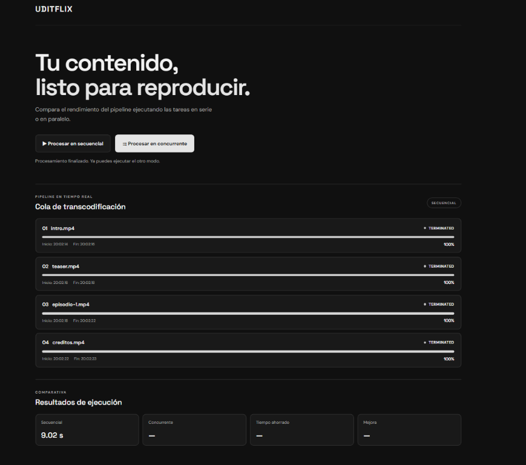
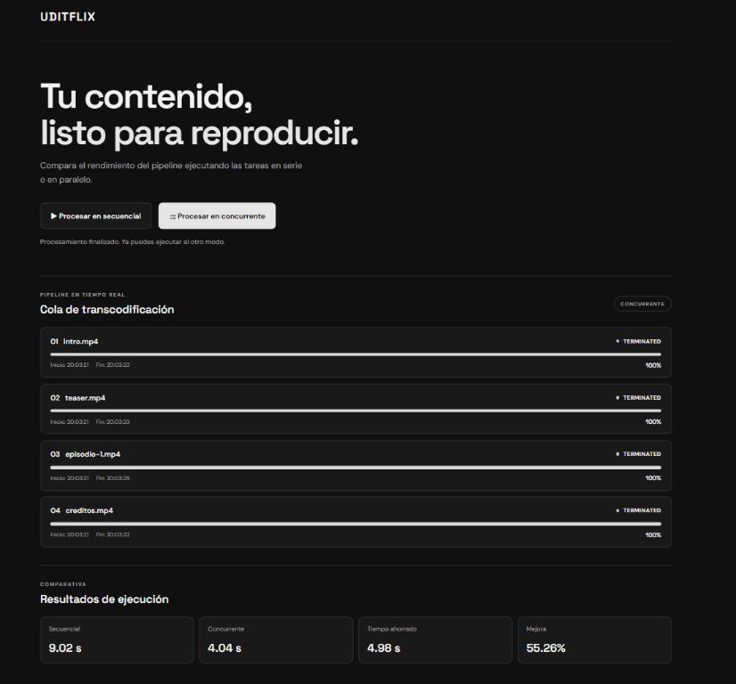

# UDITflix

Aplicación local para comparar el procesamiento secuencial y concurrente de
cuatro tareas Java desde una interfaz web.

## Requisitos

- JDK instalado y disponible desde CMD (`java` y `javac` en el `PATH`).
- Ejecutar los comandos desde la carpeta `UDITflix`.

## Compilar y ejecutar

```cmd
javac -d bin src\*.java
java -cp bin MainUDITflix
```

Al arrancar, Java inicia el servidor HTTP y abre la aplicación en el navegador.
El servidor utiliza el puerto 8080 si está disponible; si está ocupado, elige
un puerto libre. La interfaz también se puede abrir manualmente con la URL que
aparece en la consola.

## Capturas

### Procesamiento secuencial



### Procesamiento concurrente



## Uso

1. Pulsa **Procesar en secuencial** para ejecutar las tareas una después de otra.
2. Pulsa **Procesar en concurrente** para ejecutar las cuatro tareas a la vez.
3. Observa el progreso, el estado del hilo y las horas de inicio y fin.
4. Ejecuta ambos modos para comparar sus duraciones y consultar el ahorro y la
   mejora calculados.

No se puede iniciar otro procesamiento mientras haya uno en curso.

## Estructura

```text
UDITflix/
├── src/
│   ├── MainUDITflix.java
│   ├── ServidorUDITflix.java
│   └── TareaTranscodificacion.java
├── web/
│   ├── index.html
│   ├── estilos.css
│   └── app.js
├── docs/
│   └── images/          Capturas de la aplicación
└── bin/                 Clases compiladas
```

`ServidorUDITflix` sirve los recursos web y expone `/api/start` y
`/api/status`. El navegador consulta el estado cada 250 ms. Las barras y los
estados se calculan a partir de las tareas y los hilos Java, no de una
animación independiente del servidor.

## Nota sobre la transcodificación

Las tareas actuales simulan el trabajo durante las duraciones definidas en
`ServidorUDITflix.java` mediante pausas de los hilos. No procesan ni modifican
archivos de vídeo reales.
"# UDITflix" 
